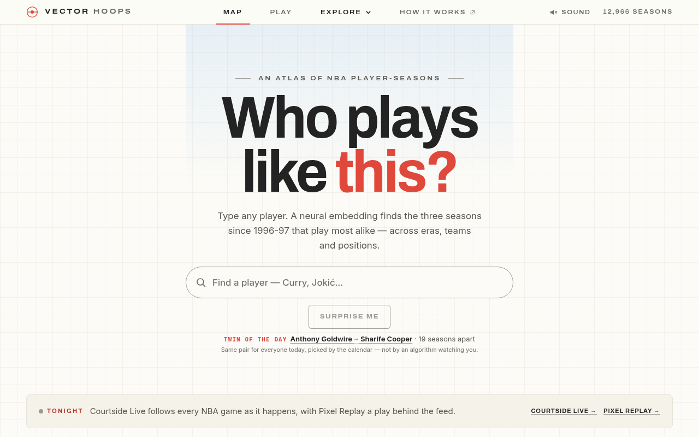
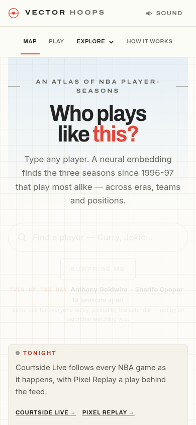
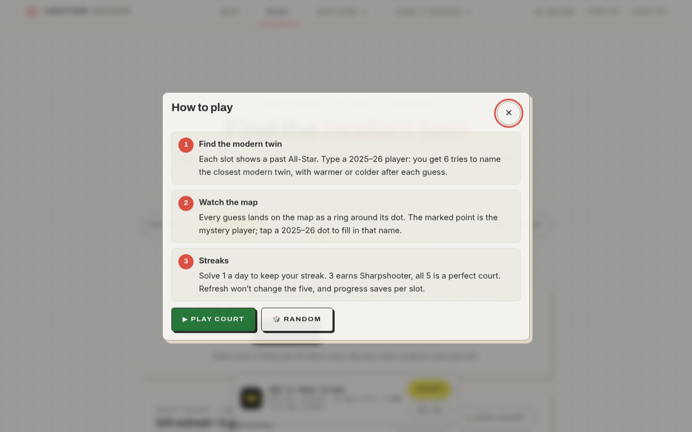
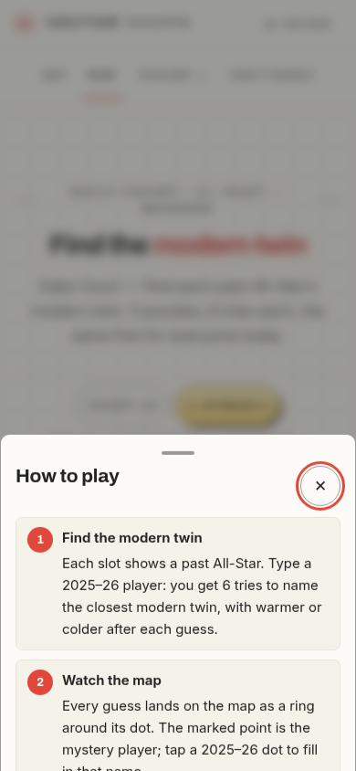
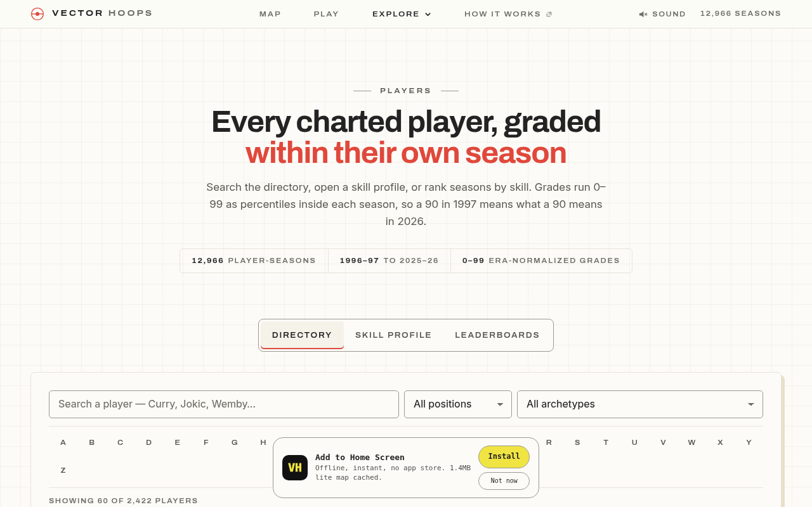
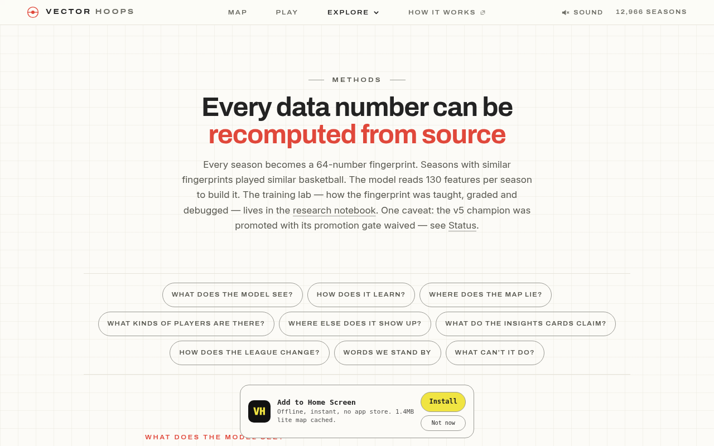

# Vector Hoops — SOTA platform upgrade

Owner goal: make [hoops.dumbmodel.com](https://hoops.dumbmodel.com) a state-of-the-art platform for NBA insights and neural-network-powered analytics — historical seasons and in-game performances.

This document is the audit, the information architecture, the design system, the key experiences, the performance/accessibility bar, and the milestones this branch executes. Numbers in the product come only from committed artifacts. Where an artifact does not exist, the UI shows a labelled empty state and the gap is listed here.

Stack stays what the repo already uses: static HTML + `atlas.css` / `shell.css` + vanilla JS, Vercel `public/` mirror, `stamp_assets.py` / `stamp_footer.py` / `sync_public.py`, Node test files wrapped by pytest. No Next.js, no new CSS framework, no Playwright (the repo has none). Justification: CI budgets, CSP `script-src 'self'`, and the byte-identical `public/` contract would all have to be rewritten for a new stack, for no visitor-facing gain in this pass.

---

## 0. Open PRs — build on or avoid

Checked 2026-11-11 against `jcdavis131/vector-hoops`.

| PR | Branch | Decision |
| --- | --- | --- |
| [#200](https://github.com/jcdavis131/vector-hoops/pull/200) Wave A A6: T15 Close focus, T16 search focus ring, T13-retry | `scout/phase2-A6-shell` | **Build T15** into `site-nav.js` (focus Close first when the Explore drawer opens). Skip T16 / T13-retry — they edit landing files this branch must not touch. |
| [#199](https://github.com/jcdavis131/vector-hoops/pull/199) Wave A A2: chip/search scroll | `scout/phase2-A2-scroll` | **Avoid.** Lands on the atlas home. |
| [#198](https://github.com/jcdavis131/vector-hoops/pull/198) Concept overlay | `scout/concept-map-overlay` | **Avoid.** Atlas coloring. |
| [#196](https://github.com/jcdavis131/vector-hoops/pull/196) landing-map-viz | `scout/landing-map-viz` | **Avoid.** `index.html`, `atlas-3d.js`, `home-tonight.js`. Live home still says “neural embedding” / “three seasons”; that copy lives on their branch. |
| [#134](https://github.com/jcdavis131/vector-hoops/pull/134) shared viz-lib | `scout/platform-p4-viz` | **Avoid.** Parallel component system. New charts here are page-local SVG. |
| [#64](https://github.com/jcdavis131/vector-hoops/pull/64) patent-motion preview | `scout/patent-motion-hoops` | **Avoid.** Motion language. Respect `prefers-reduced-motion` only. |

Waves 1–3 are already on `master`. This branch is `cursor/sota-platform-upgrade-1bd3` off current `master`.

---

## 1. Audit

Reviewed the live site (desktop 1280 and mobile 390) and the repo: routes, `assets/`, served JSON, `vercel.json`, `budgets.json`, `scripts/budget_check.py`, `scripts/check_design.py` (D1–D21), `tests/`, `sw.js`.

### 1.1 What exists today

| Surface | Route | What it is |
| --- | --- | --- |
| Atlas home | `/` | 12,966 player-seasons on a 2-D/3-D map, twin search, Tonight strip |
| Daily Court | `/play` | Daily puzzle (five past All-Stars → modern twins) |
| Map Hunt, Twenty Questions, Era Crossed | `/map-guess`, `/twenty-questions`, `/play/era-crossed` | Games |
| Pixel Replay | `/replay` | Animated court from PBP; five 2026-27 games on disk |
| Courtside Live | `/live` | ESPN scoreboard + BPI when a game is in progress |
| Schedule | `/schedule` | Seven-day slate |
| Players | `/players` | Directory, skill profile, leaderboards, **Arm 1 v5 shot-zone panel** (`#pp-shotzone-slot` ← `ShotZones.renderInto`) |
| Insights | `/insights` + slugs | Editorial findings |
| Twin Networks, Playoff Runs, Taxonomy, Guide | `/twin-network`, `/playoff-runs`, `/taxonomy`, `/guide` | Explore |
| Methods, Models | `/methods`, `/models/mtnn-v5` | Trust + champion card |
| Status / feed health / 404 / offline | `/status`, `/feed-health`, `/404`, `/offline` | Ops |

Nav: Map · Play · Explore drawer · How it works. Footer stamped from `EXPLORE` + `GAMES` in `assets/site-nav.js`.

### 1.2 Live screenshots (before)

Desktop home — atlas hero, search, Tonight strip. No season/team/game explorer, no command palette, no theme control:



Mobile home — four slots wrap onto a second row; Sound stays, “12,966 seasons” hides. Search is the atlas typeahead, not a site jump:



Daily Court opens on a how-to modal (feature kept as-is):




Players directory is strong. PWA install overlay covers the A–Z index. Shot-zone panel is behind the Skill Profile tab, not linked from Explore:



Methods is the honesty page. Live copy still says “64-number fingerprint” (D21 would flag `64-` on a non-exempt page; Methods is exempt). Install overlay again:



Headless Chrome hung on the WebGL atlas when `--virtual-time-budget` was long; the frames above used a 2.5s budget. `/live` and `/schedule` were not captured live in this pass (ESPN-backed, time-varying). Local after-screenshots of the new pages are in `docs/design/audit/after-*`.

### 1.3 Specific problems

1. **No season, team, or game object in the IA.** `/teams` permanently redirects to `/#atlas`. There is no `/seasons`, `/games`, or `/compare`. Historical insight is trapped on the map and in `/players`.
2. **In-game data is on disk and not shown as analysis.** `assets/replays/*.json` already store shooter `x,y` in court feet, make/miss, clock, score, and player ids. Replay animates them; nothing draws a shot chart, a scoring timeline, or a derived box from those events.
3. **Win probability is a Live-only ESPN BPI flag.** Replay JSON has no WP series. The product must not invent one.
4. **Forecasts exist and are unused on their own surface.** `assets/arc_priors_2026-27.json` (675 priors, challenger macro MAE 0.438 vs last-season 0.500) and `assets/eval_scoreboard.json` (test split top-1 0.438, n=790) are not surfaced as insight cards with a Methods link.
5. **Command palette / jump is missing.** Search on home is twin-search; search on Players is the directory. There is no site-wide “go to Seasons / this game”.
6. **Dark mode is OS-only.** Tokens flip under `prefers-color-scheme: dark`. No visitor control. D10 requires the dark `@media` `:root{` block to remain.
7. **Explore drawer fails T15.** Open focuses the first `.explore-item`, so Close is not the first Tab stop (`#200`).
8. **Copy drift vs data.** Home still talks like a 14-stat toy on production; embeddings are 64-d in the ledger. This branch does not edit `index.html` (conflicts with #196). New pages use D21-safe copy and artifact numbers only.
9. **PWA install toast** sits on top of Players/Methods chrome (z-index / first-visit). Out of scope to redesign the prompt; noted as UX debt.
10. **Budgets are tight.** 404 has ~3.6 KiB headroom; heaviest JS page ~0.8 KiB. Shared CSS/JS growth requires a 1.5× re-measure of `budgets.json` (the documented process). New JSON is fetched only by the pages that need it — never from `site-nav.js`.

### 1.4 Inventory — data the site already has vs what it shows

| Artifact | Shown today | This upgrade |
| --- | --- | --- |
| `player_index.json` (12,966 rows: name, season, decade, archetype, top-3 z) | Players, atlas | Compare index (derived), season counts |
| `skills.json` (12 grades 0–99, badge 90 / gold 97) | Players skill profile | Compare |
| `season_norms.json` (per-season μ/σ, **no 2007-08, 2012-13, 2013-14, no 2026-27**) | Indirectly (z-scoring) | Season explorer + labelled gaps |
| `teams.json` (30 teams) | Unused as a page (`/teams` → atlas) | Teams hub |
| `current_rosters_2026_27.json` (as of **2026-09-29** preseason camp, 607 slots) | Unused | Team pages, dated |
| `replays/index.json` + five `002260000*.json` | Pixel Replay animation | Games hub: shot chart, timeline, derived box |
| `shot_zones_2026-27.json` (Arm 1 v5) | Players skill profile panel | **Unchanged** |
| `eval_scoreboard.json` | Methods / models card | Insight cards (test split only, with n and Methods link) |
| `arc_priors_2026-27.json` | Not a first-class page | Insight card on Compare (MAE vs naive/avg3, not “accuracy”) |
| `site_facts.json` | Footer / facts | Unchanged |

### 1.5 Data gaps (empty states, never mock)

| Gap | Empty-state copy |
| --- | --- |
| No `gamelogs_*.jsonl` for any season; no 2026-27 box-score dump | “Per-game logs for 2026-27 are not in the ledger yet.” |
| Only five PBP/replay games | Games hub lists those five; other dates point at Schedule / Live |
| No win-probability series in replay JSON | “No win-probability series is in these files. Live games show ESPN BPI on Courtside Live when that feed is up.” |
| `season_norms.json` missing 2007-08, 2012-13, 2013-14 | Gap ticks on the season rail |
| No 2026-27 season norms | “2026-27 is in progress; league μ/σ are not in the ledger.” |
| Rosters are preseason as of 2026-09-29 | Dated caption, not “opening night roster” |
| Shot-chart JSONL (BBR hoop-centered) does not match replay court-feet coords | **Do not wire JSONL.** Charts use replay `x,y` only |
| `knowledge/players/*.md` missing | No dossier prose on team/player objects |
| `projections.json` / TimesFM on Players unused | Leave Players TimesFM as-is; do not advertise a second forecast |
| No per-player URL | `/players?q=` remains the player object; compare deep-links by name+season |

Hard rule: never print “accuracy is 93%”. Retrieval is top-k on a named split from `eval_scoreboard.json`. Forecaster quality is MAE from `arc_priors_2026-27.json`.

---

## 2. Information architecture

Keep the four-slot nav. Add destinations to **Explore** (and therefore the stamped footer):

```
Map (/)                Play (/play)
Explore                How it works (/methods)
  Atlas
  Seasons          ← new  /seasons
  Teams            ← new  /teams   (un-retire; drop the /#atlas redirect)
  Games            ← new  /games   (replay shot charts + timeline)
  Players
  Compare          ← new  /compare
  Live / Schedule / Replay (existing)
  Insights / Twin Networks / Playoff Runs / Taxonomy / Guide
  Methods / Models
```

Object model (query-routed, not a file per entity — keeps budgets and CSP):

| Object | URL | Source of truth |
| --- | --- | --- |
| Season | `/seasons?season=2015-16` | `season_norms.json` |
| Team | `/teams?team=BOS` | `teams.json` + `current_rosters_2026_27.json` + replay index |
| Game | `/games?id=0022600001` | `assets/replays/{id}.json` |
| Player-season | `/players?q=Curry` (existing) | `player_index.json` + skills + shot zones |
| Compare | `/compare?a=Name:season&b=Name:season` | derived `compare_index.json` |

Command palette (Ctrl/⌘K, “Jump”) lists Explore+Games already in `site-nav.js`. A query that matches no page offers “Search players for … → `/players?q=`”. **No extra JSON fetch from the nav** (would count on every page, including 404).

---

## 3. Design system

Keep **Drafting Board**: paper `--board` `#FCFBF7`, ink `#232323`, marker-red accent, 8px space, Archivo display / Inter text, radii 5/7/10.

| Layer | Rule |
| --- | --- |
| Type | Existing scale `--t-2xs`…`--t-hero`. Nothing under 11px. 16px on inputs (iOS zoom). Tabular nums on stats. |
| Color | Tokens only in `atlas.css` (D4). No hex outside it (D6). Status uses `--ok-text` / `--warn-text` / `--bad-text` (AA). |
| Dark | Keep `@media (prefers-color-scheme: dark){ :root{` (D10). Add `:root[data-theme="light"|"dark"]` overrides for the nav toggle. Default remains OS follow (`data-theme` absent). |
| Spacing | `--s-2`…`--s-9`, `--gutter`, `--content`. New pages: `min(1180px, 100%)` column. |
| Motion | `--dur-1/2/3`, `--ease`. Palette fade only. `prefers-reduced-motion` already zeroes animation in `atlas.css`. Do not take #64. |
| Components | Reuse `.title-card`, `.card`, `.btn`, `.pill`, `.input`, `.map-note`. Add kit `.empty-state` and `.insight-card` in `atlas.css` (small). Command palette + theme/jump buttons in `shell.css`. |
| Insight card | Kicker (source file) · metric with n · one-sentence caveat · link to `/methods`. Never a lone percentage. |
| Empty state | Dashed `--line-2` panel, title, why it’s empty, what artifact would fill it. |

Theme toggle cycles `auto → light → dark → auto`, stored in `localStorage['vh.theme']`.

---

## 4. Key experiences (this branch)

### 4.1 Season explorer — `/seasons`

Rail of seasons 1996-97…2026-27 from the calendar, not from a typed list. A season present in `season_norms.json` shows `n` and available feature μ (PTS, FG3A, …) as a small multiple-series chart. Missing ledger years (2007-08, 2012-13, 2013-14) and 2026-27 are gap/empty states. Insight card: held-out next-season retrieval from `eval_scoreboard.json` **test split** (n=790, top-1 0.438, top-5 0.757) vs 14-stat baseline test top-1 0.0785, with Methods link. No model-name jargon (D21).

### 4.2 Team pages — `/teams`

30 teams from `teams.json`. Selecting a team shows the **2026-09-29** ESPN preseason roster (status + position as in the file) and any of the five replay games involving that tri-code. Empty: “No 2026-27 game logs in the ledger beyond the five play-by-play games on Games.” Player names link to `/players?q=`.

### 4.3 Game pages — `/games`

Index of `assets/replays/index.json` (five finals). Opening a game:

- Header: date, tri-codes, final score from the file.
- **Shot chart** from event `x,y` in court feet (already converted by `pipeline/build_replays.py`; this branch does not touch that pipeline). Makes vs misses, 2s vs 3s. Caption states source and the `check.shots` count.
- **Event timeline** of scoring plays (clock, description, running score).
- **In-game board**: per-player makes/attempts/points **derived from the same events** (2pt/3pt/FT). Not a fabricated box score.
- **Win probability**: empty state (gap above). Link to `/live`.

Pixel Replay remains the animation. This page is the analytic sibling.

### 4.4 Shot charts

Only replay coordinates. Do not plot BBR JSONL. Court is 94×50 ft SVG, baskets at 5.25 and 88.75 ft. Reduced-motion: static SVG (no animation).

### 4.5 Model insight cards

| Card | Artifact | Honest framing |
| --- | --- | --- |
| Next-season retrieval | `eval_scoreboard.json` → `results.mtnn.by_split.test` | “Held-out test split, n=790: 43.8% of queries retrieve the same player’s next season in the top 1; 75.7% in the top 5. The 14-stat baseline on the same split is 7.9% / 19.6%.” |
| 2026-27 priors | `arc_priors_2026-27.json` → `forecaster_metrics` | “Ridge prior vs last-season and 3-year average, macro MAE 0.438 vs 0.500 vs 0.495 (z-space fields on the artifact). Not a shooting-percentage accuracy.” |
| Skill grades | `skills.json` `badgeGrade` / `goldGrade` | “Within-season percentiles 0–99. 90 is a badge, 97 is gold. Not a forecast.” |

Every card links `/methods`.

### 4.6 Compare — `/compare`

Two typeaheads over `compare_index.json` (compact projection of `player_index` + aligned `skills.grades`; generated, not hand-typed). Side-by-side 12 skill bars and deltas. Empty until both sides resolve. Deep link `?a=Name:season&b=Name:season`.

### 4.7 Search / command palette

Destination list = `EXPLORE` ∪ `GAMES` already parsed by `site-nav.js`. Player fallback → `/players?q=`. T15 Close-first on the Explore drawer.

### 4.8 Existing features (must keep working)

Daily Court, shot-zone panel + `shot_zones_2026-27.json`, Live, Replay, Methods, Models, atlas, all games. No edits to training, served weights, or ingest paths. No edits to `.github/workflows/*`.

---

## 5. Performance and accessibility

| Target | How |
| --- | --- |
| Gate 1 page bytes | New pages get 1.5× measured budgets (32 KiB floor). Existing pages: re-measure at 1.5× after shared CSS/JS growth (documented in `budgets.json`). |
| Gate 2 JS | Command palette + theme live in `site-nav.js` (already on every page). Keep the addition small; no `player_index` fetch from nav. |
| Gate 3 | `stamp_assets`, `sync_public`, `check_site_facts` stay green. |
| LCP / INP / CLS | Static HTML, system/self-hosted fonts already in `fonts.css`, no layout-shifting ads. New charts are inline SVG (no webfont icons). |
| WCAG 2.2 AA | `check_a11y.py` + `check_contrast.py`. One `h1`, `main`, labelled inputs, 44×44 targets (2.5.8), focus-visible (existing shell), `lang`, unique titles. Palette: focus trap, Escape, `aria-modal`. |
| CSP | No inline scripts (D14). |

Recommended workflow change (**not in this PR**): add the four new routes to whatever smoke job hits `/play` and `/players`, and consider a Playwright job later. Owner’s ops agent owns `.github/workflows/*`.

---

## 6. Milestones and acceptance criteria

### M0 — Plan and audit (this file)

- [x] Live + repo audit, open-PR table, data gaps, IA, system, AC.

### M1 — Shell

AC:

- Explore lists Seasons, Teams, Games, Compare; footer stamp matches.
- Drawer open focuses **Close** (T15).
- Theme toggle: auto/light/dark; D10 still sees `@media (prefers-color-scheme: dark)` + `:root{`.
- Jump palette (Ctrl/⌘K) filters destinations; unmatched query offers Players search.
- Daily Court and Players shot-zone slot still present in markup.

### M2 — Season / team / game / compare

AC:

- `/seasons` renders `n` and feature μ from `season_norms.json`; gaps labelled; 2026-27 empty.
- `/teams` lists 30; roster dated 2026-09-29; `/teams` is a rewrite, not a redirect to the atlas.
- `/games` lists five replay games; shot chart count equals `check.shots`; WP empty state visible; box derived from events.
- `/compare` loads `compare_index.json` only; grades match `skills.json` for the same player-season.
- Insight cards quote eval/MAE with n and Methods.

### M3 — Tests, budgets, screenshots

AC:

- New Node tests + pytest wrappers; `test_site.py` includes the new pages.
- `ruff`, `check_design.py` D1+D14, `budget_check.py` pass.
- `budgets.json` updated via `--measure` for new pages and shared-file growth.
- Before/after desktop+mobile stills in this folder and the PR body.

### M4 — Out of scope (named so they are not faked)

- Per-player routes, 2026-27 gamelogs, WP model, wiring BBR shot JSONL, landing-map copy (#196), viz-lib (#134), patent motion (#64), workflow YAML, Vercel dashboard / DNS, deploy, merge.

---

## 7. Workflow recommendations (owner / ops agent)

1. After merge, the existing `site` job already runs `budget_check.py` and ruff — no YAML change required if `budgets.json` lands in the same PR.
2. Optional later: add `/seasons`, `/teams`, `/games`, `/compare` to any curl smoke list in CI.
3. Optional later: Playwright for palette + theme; this repo currently wraps `node:test` in pytest.
4. Bump `sw.js` `CACHE_NAME` (this PR does v43 → v44) because `atlas.css`, `shell.css`, and `site-nav.js` are in CORE.

---

## 8. What this branch will not do

- Invent stats, WP, or accuracy figures.
- Edit `.github/workflows/*`.
- Edit training, served ONNX/weights, or `pipeline/build_replays.py` coordinate conversion.
- Merge, deploy, or touch Vercel/DNS.
- Conflict with #196–200 / #134 / #64 on shared landing and motion files.
