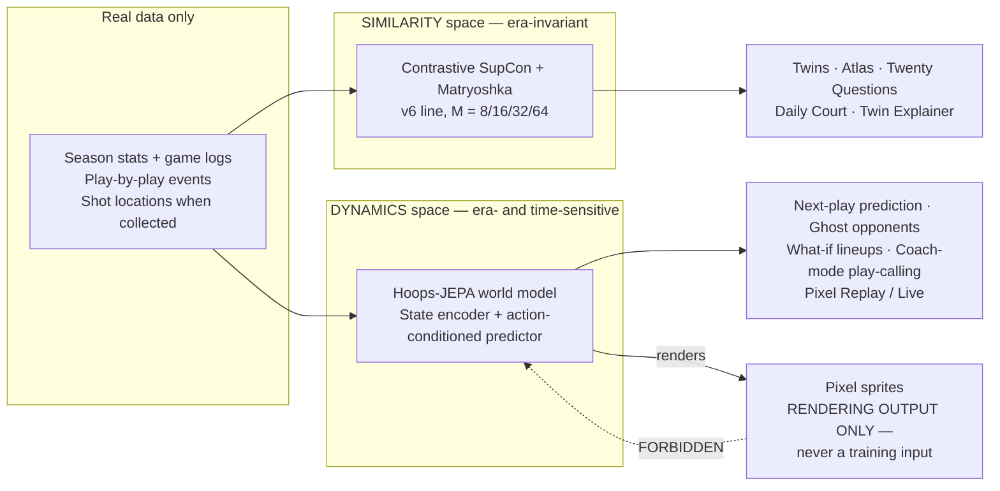

# Lane 8 — Division of Labor: Two Spaces, Two Jobs

**Status:** DESIGN ONLY. No training, no GPU, no package installs, no prod
writes, no merge. Train gate closed (contract §0).
**Authority:** Contract §7 (user decision 2026-10-26), which REPLACES the
challenger framing for this pair. This doc implements §7; it does not
re-litigate it.
**Companion docs (same lane):** `JEPA_DESIGN.md` (the dynamics model),
`INTEGRATION_ADDENDUM.md` (what changes in Lane 6's map).

## 0. The decision, in one paragraph

There is NO challenger and NO promotion fight between the contrastive
model and JEPA. BOTH SHIP, for different jobs. The contrastive
SupCon + Matryoshka line (the v6 line) is the SIMILARITY space: who
plays like whom, across eras. Hoops-JEPA is the DYNAMICS space: what
happens next, given a game state and an action. A model that would
REPLACE the v5 twin space is still judged by the contract §2d
promotion gate, unchanged. JEPA does not compete for that space and is
NOT judged by the twin gate; it gets its own eval, sketched in
`JEPA_DESIGN.md` §5. The word "challenger" in this contract henceforth
means ONLY "candidate to replace the v5 twin space."

## 1. Diagram

The forbidden arrow is the point. Sprites render what the world model
predicts; they never feed it. See §5 and `INTEGRATION_ADDENDUM.md` §2.

## 2. The table: one row per space

| | SIMILARITY space | DYNAMICS space |
|---|---|---|
| **Model** | Contrastive SupCon + Matryoshka (v6 line); champion today is MTNN v5, 64-d L2, 12,966 player-seasons through 2025-26, `assets/mtnn_embeddings.f32`, incumbent 2026-07-25 | Hoops-JEPA world model (design only in this pass): game-state encoder + action-conditioned predictor → next state; V-JEPA 2-AC pattern at small scale (see `JEPA_DESIGN.md` §3) |
| **Job** | Retrieval: who plays like whom, across eras | Prediction + planning: what happens next, given a game state and an action |
| **Inputs** | Player-season feature vectors (17 tower families; the wide training matrix is the subject of the Lane 7 overhaul — its verified base width today is 73 columns, not the contract's 120; see contract §6 and Lane 7 `INVENTORY.md` §2.4) | Game states over time: game logs, play-by-play events, shot locations when collected, plus score, clock, lineup, matchup, and season context (see `JEPA_DESIGN.md` §1 for what exists today vs. what is missing) |
| **Outputs** | One vector per player-season; nearest neighbours are twins. Slice + re-normalize serves widths 8/16/32/64 from one versioned asset | Predicted next latent state(s) given a state and an action; rolled forward, a predicted sequence of states (a planned or simulated stretch of game) |
| **Surfaces powered** | Twins, Atlas map, Twenty Questions, Daily Court, Twin Explainer (see `INTEGRATION_ADDENDUM.md` §1 for the per-surface column) | Next-play prediction, ghost opponents, what-if lineup simulations, coach-mode play-calling, Pixel Replay / Live (next-play + ghosts) |
| **Invariance required** | ERA-INVARIANT: a player's vector must sit near stylistically similar players from other eras, regardless of the season it was recorded in | ERA- AND TIME-SENSITIVE: the model must know what season it is in, what the score and lineup are, and what comes next. Era, score, clock, and lineup are inputs, never nuisances to be normalized away |
| **Eval that judges it** | Contract §2d promotion gate, unchanged: beat the v5 champion on ALL primary retrieval metrics (top-1, recall@10, continuity, twin-agreement, new-player slice) on BOTH val folds and the frozen 2025-26 test, at 64-d; plus the user's separate word. 16-d must retain ≥ 90% of 64-d top-1 to earn the serving-unification story | JEPA's own eval (sketch in `JEPA_DESIGN.md` §5): next-play prediction quality, planning quality, ghost believability — on held-out games, never on training games, and never against the twin gate |

## 3. The conflicting-invariances argument

This is the research reason for two models, stated plainly rather than
hand-waved.

**The similarity side needs era to disappear.** The question "who plays
like whom" is only interesting if the answer can cross eras. Curry
2016-17 must sit near Ginobili 2009-10 (the post-fix Twin Reveal pair
in the 14-d stat space; note honestly that in the 64-d champion
embedding space that pair's cosine is 0.4003 at rank 390th
person-excluded, while the 64-d top twin is James Harden 2017-18 at
0.86 — contract §5, coordinator-measured). Whichever space a twin
claim is made in, the space must be built so that a 2009 season and a
2016 season are comparable on style alone. Training for that means
rewarding the model when it puts same-style players from different
eras close together, and penalizing it when era itself separates them.
Era is noise to be removed.

**The dynamics side needs era — and time — to stay.** Consider a
concrete dynamics question: it is the 4th quarter, 2 minutes left,
score tied, the lineup on the floor is a small-ball five with no true
center, and the coach calls a high pick-and-roll with the star guard
as ball-handler. What happens next? A model that has had era and
time normalized away cannot answer this well, for three reasons:

1. **Era changes what "next" looks like.** The same lineup shape and
   the same play call produce different next states in 2009 (a league
   that shot far fewer threes, where the pick-and-roll big rolled to
   the rim) than in 2025 (a league where that big pops to the arc and
   the defense switches everything). A dynamics model must know the
   season, because the season is part of the state that determines
   the transition.
2. **Score and clock change behavior.** Tied with 2 minutes left is
   not the same state as up 20 in the 2nd quarter, even with the
   same five players and the same play call. Urgency, fouling,
   timeout use, and shot selection all shift. Score and clock are
   state, not metadata.
3. **Lineup and matchup are the action's context.** The same play
   call with a different screener, or against a switching defense
   versus a drop defense, leads to a different next state. If the
   model is trained to be invariant to who is on the floor, it has
   thrown away exactly the information the prediction needs.

**Forcing one vector to do both creates objective interference.**
"Be invariant to era" and "be sensitive to era" are opposite
instructions to the same representation. A single training objective
that rewards both will satisfy neither cleanly: the retrieval
neighbours get polluted by era/time signal, and the dynamics
predictions get blurred by era-invariance pressure. Splitting the
jobs across two models removes the interference at the source. Each
model's objective is coherent on its own terms, and each is judged
by an eval that matches its job (§2 table, last row).

## 4. The shared-stem rule

**Default: SEPARATE, not shared.** The similarity encoder and the
JEPA state encoder are separate models with separate training
objectives, separate evals, and separate serving assets, unless and
until an eval says otherwise.

**Sharing is allowed ONLY if evals support it.** A shared encoder
stem (one encoder trunk feeding both a retrieval head and a JEPA
predictor) may be proposed only with a named eval that justifies it.
The eval that would justify sharing is a joint, both-axes comparison
on held-out data:

- The shared-stem model must match or beat the separate similarity
  model on the contract §2d retrieval primaries (top-1, recall@10,
  continuity, new-player slice) at 64-d on val and frozen test, AND
- The shared-stem model must match or beat the separate JEPA model
  on the JEPA eval sketch (`JEPA_DESIGN.md` §5: next-play prediction
  quality and planning quality) on held-out games, AND
- Neither axis may regress relative to its separate-model baseline.
  A win on one axis that costs the other axis is not a justification
  for sharing — it is the interference this division exists to avoid.

Until that eval exists and passes on both axes, any design, diagram,
or plan that draws one box for both jobs is wrong. This doc draws
two boxes.

**What sharing would NOT change even if it passed:** the gate
scoping in §0. A shared stem that also replaced the v5 twin space
would still face the §2d promotion gate for that space, and the
user's separate word, before any production switch.

### 4.1 Amendment — unified-loss refinement (2026-10-26 voice call, recorded after this doc's first draft)

Standing context added 2026-10-26 records a user refinement: whether
both models can train together under one global loss and learn from
each other. The recorded research answer: yes, in principle —
UniJEPA (2026) unifies invariant (contrastive-like) and equivariant
(temporal) prediction in one latent space with a single loss plus a
Gaussian anti-collapse regularizer; DreamerV3/MuDreamer formalize
encoder↔dynamics KL balancing; multi-task conflict tools are
uncertainty weighting, GradNorm, PCGrad, and MGDA/Pareto. The
proposed Hoops unified design in that record is: a shared tower
stem, a Matryoshka SupCon head (twin space) plus a JEPA predictor
head whose target IS the contrastive embedding of the true next
season (the world model plans IN twin space), a bridge plus
predictive positives, weights via uncertainty weighting, and PCGrad
on conflict. The killer joint-only metric in that record is "future
twins": predict next season, retrieve its twins.

**How this amendment fits §4 without overriding it:** the rule kept
in that same record is "separate baselines first as ablation
controls; joint must not regress either head and must win a joint
metric." That IS the §4 eval gate, made concrete: the unified model
is a candidate sharing proposal, and it earns sharing only by (a)
matching/beating the separate similarity baseline on the §2d
retrieval primaries, (b) matching/beating the separate JEPA baseline
on the JEPA eval sketch, and (c) winning the joint-only "future
twins" metric. A joint model that regresses either head fails the
gate even if it wins the joint metric, and a joint model that wins
neither head but wins the joint metric has not justified sharing —
it has justified a third model. Two tensions are flagged for the
coordinator, not resolved here: (1) the unified record's predictor
target is the NEXT SEASON's embedding (season timescale), while
this lane's JEPA design (§3 of `JEPA_DESIGN.md`) predicts the NEXT
GAME STATE (game timescale) — a unified design must state which
timescale its predictor operates on, or how both are served, rather
than blurring them; (2) the UniJEPA/DreamerV3/MuDreamer claims in
this amendment are recorded from standing context, not verified
against the `jepa-predictor-paper` skill's references in this lane,
and must be citation-checked before they are used as design
authority. Design only — no training authorized by this amendment.

## 5. The pixel-game loop (binding, restated here; full form in the addendum)

Real data → world model predicts next latent states → sprites render
those states. NEVER sprite animation positions as training input.
Sprite positions are rendering output, not measurement; using them
as inputs would train the model on its own output. Any pipeline stage
that reads sprite positions as data fails review (Lane 7
`INVENTORY.md` §3 states the same rule for the data side).

## 6. Gate scoping (contract §7 amendment to §2d, restated)

- The §2d promotion gate applies, unchanged, to ANY model that would
  REPLACE the v5 twin space. That space keeps its own bar, and
  promotion itself needs the user's separate word after the report.
- JEPA does not compete for that space and is NOT judged by the twin
  gate. Judging a dynamics model by retrieval metrics, or a retrieval
  model by next-play accuracy, is a category error. Each model is
  judged by the eval in the §2 table.
- This scoping does not lower any bar. It assigns each bar to the
  job it was built for.

## 7. What this doc does NOT claim

- JEPA is NOT built, trained, or evaluated. It is a design in this
  pass. Any sentence in this lane that sounds like a JEPA result is
  either a design target or a labeled paper claim — never a measured
  Hoops-JEPA number. No such numbers exist yet, and none are invented
  here.
- Paper claims are traceable to the `jepa-predictor-paper` skill's
  references (see `JEPA_DESIGN.md` §3.1). The H-JEPA-style top-down
  planning in `JEPA_DESIGN.md` §4 is a DESIGN NOTE from the user's
  stated pattern, not a paper claim and not a built component.
- The downstream spec's D3 dual-use requirement (see §8) is NOT
  adopted here; §7 of the contract supersedes it for this pair.

## 8. Contract conflict found (reported, not silently reinterpreted)

**DOWNSTREAM.md §D3 vs. contract §7.** The prior downstream spec
(`~/workspace/vector-hoops-mlops-v2/specs/entity-anchors/DOWNSTREAM.md`
§D3, "The world model") requires the world model to "beat the v5
champion on twin retrieval AND on forecasting features" — a dual-use
gate that fuses the two jobs into one model. Contract §7 (user
decision 2026-10-26) explicitly replaces that framing for this pair:
the twin gate applies to the similarity space only, and JEPA gets its
own eval. This lane follows §7, the later binding decision. The
coordinator should note the D3 wording as superseded for the
similarity/dynamics pair (D3's snapshot and held-out-win discipline
is unaffected and still applies to any model that would replace v5).
No other contract conflict was found in this lane's reading; the
width dispute (120 vs. 130 vs. 143 vs. 73) is Lane 7's open re-pin
decision, not a conflict this lane resolves.
